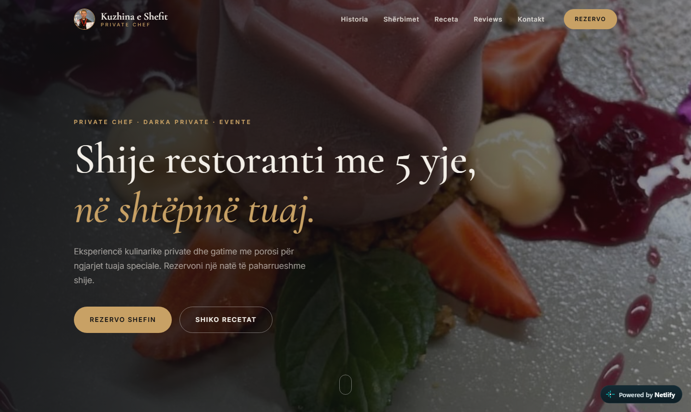
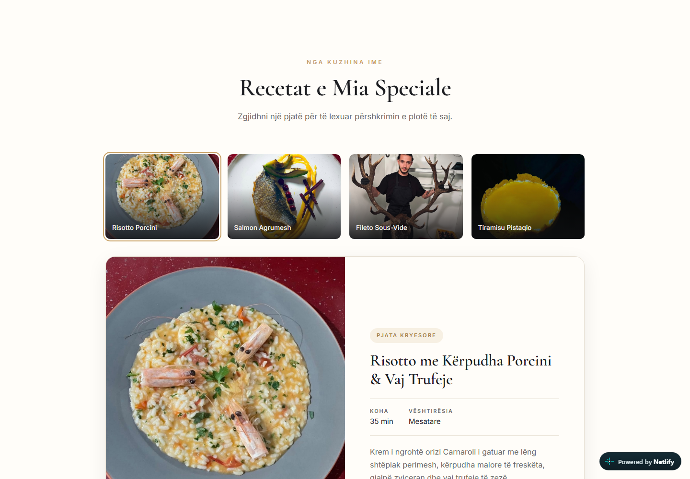
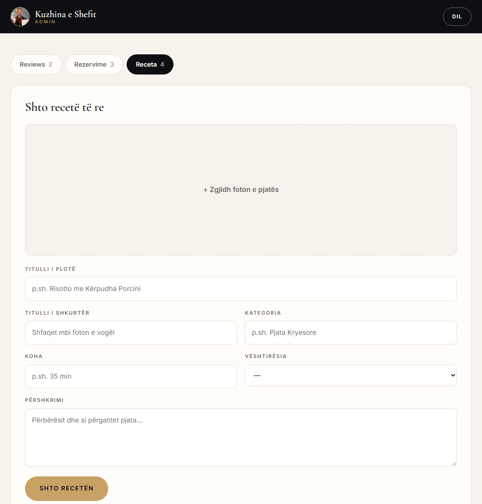
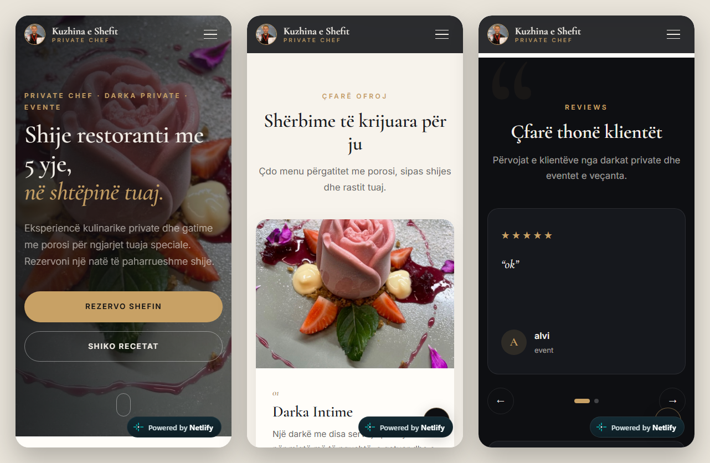
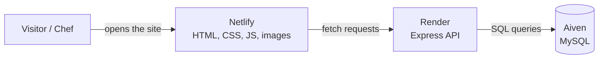

# Kuzhina e Shefit – Private Chef Website

A full-stack website for a private chef. Visitors can browse his recipes, read and leave reviews, and send a booking request for their event. The chef manages everything from a password-protected admin dashboard.

**🔗 Live site:** [kuzhinaaleksit.netlify.app](https://kuzhinaaleksit.netlify.app)



## Features

**For visitors**
- Responsive design for phone, tablet and desktop
- Chef's story in a tabbed timeline, plus a services section
- Recipe gallery: pick a dish to see its photo, prep time, difficulty and description
- Reviews slider with a 1–5 star rating form
- Booking form in a modal window
- SEO tags and structured data, so search engines understand the page

**For the chef (admin dashboard at `/admin`)**
- Password-protected login
- Read and delete reviews
- See booking requests (name, email, event date)
- Add recipes with a photo upload, and delete recipes; changes appear on the site right away

## Screenshots

| Recipes | Admin dashboard |
|---|---|
|  |  |



## Tech stack

| Layer | Technology | Hosting |
|---|---|---|
| Frontend | HTML, CSS, vanilla JavaScript | [Netlify](https://www.netlify.com/) |
| Backend | Node.js, Express | [Render](https://render.com/) |
| Database | MySQL (`mysql2`) | [Aiven](https://aiven.io/) |

## How it works



- The static website is served by **Netlify**.
- The website's JavaScript calls the **Express API** on Render for reviews, bookings and recipes.
- The API reads from and writes to a **MySQL database** on Aiven. The tables are created automatically on startup from [`schema.sql`](schema.sql).
- Pushing to `main` on GitHub redeploys both Netlify and Render automatically.

## Project structure

```
├── index.html      Main website
├── style.css       Styles for the website and admin page
├── script.js       Website logic: tabs, recipes, reviews slider, forms
├── admin.html      Admin dashboard page
├── admin.js        Admin logic: login, lists, delete, recipe upload
├── server.js       Express API
├── schema.sql      Database tables
├── netlify.toml    Netlify config (hides backend files from the website)
└── *.jpg           Photos
```

## API

| Method | Endpoint | Description | Auth |
|---|---|---|---|
| GET | `/api/reviews` | Latest 50 reviews | – |
| POST | `/api/reviews` | Add a review | – |
| POST | `/api/bookings` | Send a booking request | – |
| GET | `/api/recipes` | All recipes | – |
| GET | `/api/recipes/:id/image` | Photo of an uploaded recipe | – |
| GET | `/api/admin/check` | Check the admin password | Admin |
| GET | `/api/admin/reviews` | All reviews | Admin |
| GET | `/api/admin/bookings` | All booking requests | Admin |
| POST | `/api/admin/recipes` | Add a recipe with a photo | Admin |
| DELETE | `/api/admin/reviews/:id` | Delete a review | Admin |
| DELETE | `/api/admin/bookings/:id` | Delete a booking | Admin |
| DELETE | `/api/admin/recipes/:id` | Delete a recipe | Admin |

Admin requests send the password as `Authorization: Bearer <password>`.

## Security

- **XSS protection:** all user text is escaped before it is shown on the page.
- **SQL injection protection:** every query uses parameterized placeholders (`?`).
- **Input validation:** length limits, email and date checks, star rating range, photo type and size.
- **Spam protection:** each visitor can send at most 5 reviews or bookings every 15 minutes.
- **Admin login:** the password is stored only as an environment variable on the server, compared in constant time, and locked for 15 minutes after 10 wrong attempts.
- **Secrets:** `.env` is git-ignored, and backend files are blocked from being served on Netlify.

## Running locally

1. Install dependencies:
   ```bash
   npm install
   ```
2. Create a `.env` file in the project folder:
   ```env
   DB_PASSWORD=your-database-password
   ADMIN_PASSWORD=choose-an-admin-password
   # Optional – defaults point to the production database:
   # DB_HOST=...
   # DB_PORT=...
   # DB_USER=...
   # DB_NAME=...
   ```
3. Start the API:
   ```bash
   npm start
   ```
   It runs on `http://localhost:5000`.
4. Open `index.html` with a local server, such as the VS Code **Live Server** extension.

   The website calls the live API by default. To use your local API instead, change `API_URL` at the top of `script.js` and `admin.js` to `http://localhost:5000`.

## Author

Built by **Elvis Dyrmishi** ([@ElvisDyrmishi-SEN](https://github.com/ElvisDyrmishi-SEN)) for a private chef client.
